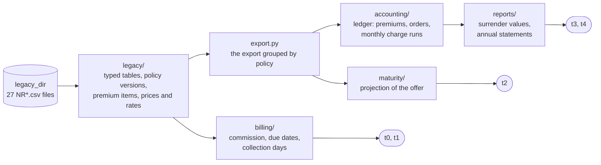
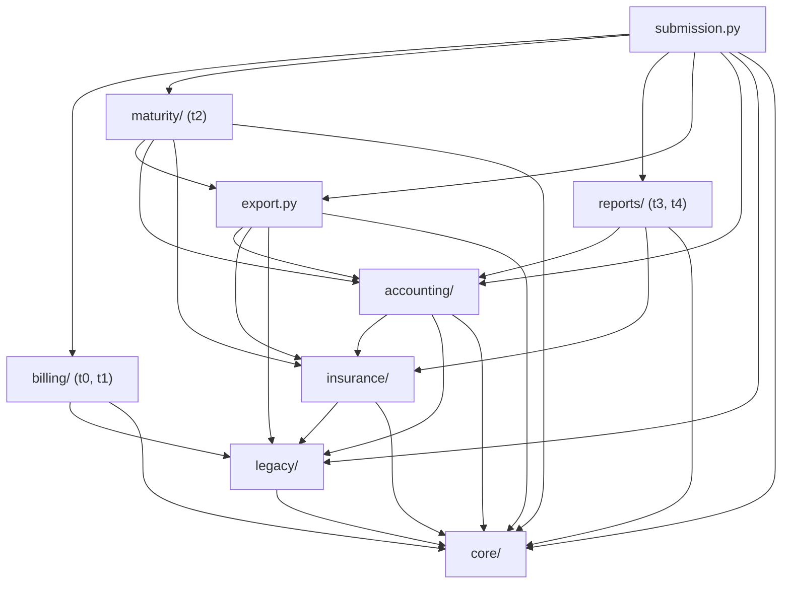
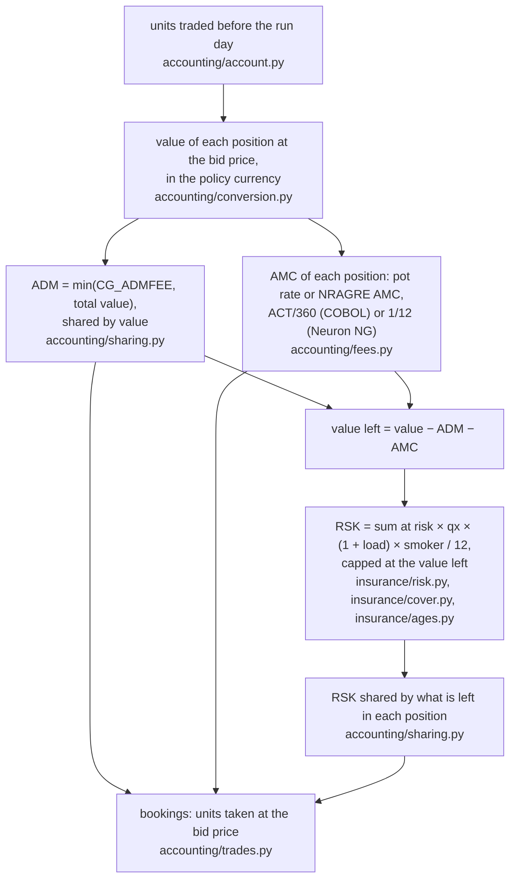

# Architecture of the Neuron migration

The submission rebuilds the hidden rules of Neuron, the legacy policy administration system, as
deterministic Python. `submission.py` is the only entry point; it reads the 27 `NR*.csv` files of
`legacy_dir` and nothing else, and returns the values of each task in the format of `scoring.py`.
Amounts are `decimal.Decimal` end to end, dates are `datetime.date`.

This page is the map: the folders and what each holds (§1–2), who may import whom (§3), the
path of every task through the code (§4), the monthly charge run that drives t3 and t4 (§5),
which table of the export feeds which module (§6), where each rule of Neuron lives (§7), how
the code keeps a high maintainability index (§8), and how to check a change (§9).

## 1. The system in one picture

Data flows from the export through the packages to the five tasks:



`insurance/` (insurance age, sum at risk, risk charge) serves both `maturity/` and `accounting/`;
`core/` (money by era, months, lookups) and `conventions.py` (every constant) serve everyone.
t3 and t4 share one engine: the same ledger of each policy gives its surrender values and its
statements.

## 2. Folder map

```text
my_solution/
├── submission.py         entry point: one function per task, t0 … t5
├── conventions.py        every constant of Neuron, next to the evidence that fixed it
├── export.py             Export (every table, grouped by policy) and Contract (one policy)
├── core/                 arithmetic and calendar shared by every rule
│   ├── money.py          rounding by era: COBOL truncates, Neuron NG rounds half up
│   ├── months.py         whole months, the day clamped to the month end
│   └── lookup.py         rows valid on a day, grouping of rows
├── legacy/               reading the export the way Neuron wrote it
│   ├── tables.py         any NR*.csv, every column typed by the data dictionary NRDICT
│   ├── formats.py        CYYMMDD dates (impossible ones too), implied decimals
│   ├── portfolio.py      policy versions (NRPOLH): the version valid on a day
│   ├── premiums.py       paid premium items (NRPREM), premium type of the tariff
│   └── market.py         fund prices (latest restatement wins), CHF rates (lower-case codes count)
├── insurance/            the death cover
│   ├── age_rules.py      age at the start: COBOL days / 365, Neuron NG completed months
│   ├── ages.py           insurance age on a day, completed policy years
│   ├── cover.py          sum at risk of the options A, B and C
│   └── risk.py           monthly risk charge: qx, loading, smoker factor
├── accounting/           the unit account, engine of t3 and t4
│   ├── account.py        Booking and Account: units per position (fund, pot) and their value
│   ├── conversion.py     cross rate through CHF, value of units
│   ├── trades.py         units taken by a charge, bought by a premium
│   ├── purchase.py       pot of a premium, gross and net of a premium share
│   ├── investment.py     PRM bookings: allocation, entry charge, trade day
│   ├── orders.py         customer orders of NRBOOK, without reversed or corrected events
│   ├── runs.py           calendar of a policy: run days, valuation days, statement years
│   ├── fees.py           AMC: ACT/360 under COBOL, a twelfth of the year under Neuron NG
│   ├── sharing.py        pro-rata split, rounding rest to the largest position
│   ├── charges.py        one monthly run: ADM, AMC and RSK
│   └── ledger.py         all bookings of a policy, run after run
├── reports/              what the customer sees, read from the ledger
│   ├── valuation.py      t3: policy value and penalty on a valuation date
│   ├── surrender.py      t3: surrender value, never below zero
│   └── statement.py      t4: yearly sums of the bookings
├── billing/              the premiums due and what they earn the broker
│   ├── commission.py     t0: broker on the money date, rate of the broker's tier
│   ├── schedule.py       t1: due dates (COBOL drift, then a Neuron NG anchor)
│   ├── collection.py     t1: collection day by payment method
│   └── business_days.py  t1: Ticino business days
└── maturity/             the projection of the offer, t2
    ├── offer.py          the figures valid on the application date
    ├── instalments.py    the months with a premium
    ├── illustration.py   one month of the projection
    └── projection.py     the whole term, month by month
```

Every package has an `__init__.py` whose docstring says what it holds.

## 3. Layers: who may import whom

A package imports only the packages below it. Every package also reads `conventions.py`.



| Layer | Unit | Holds | Imports |
|---|---|---|---|
| 0 | `conventions.py` | constants | nothing of ours |
| 1 | `core/` | money, months, lookup | conventions |
| 2 | `legacy/` | reading the export | core |
| 3 | `insurance/` | age, cover, risk charge | legacy, core |
| 4 | `accounting/` | the unit account | insurance, legacy, core |
| 5 | `reports/` | t3 and t4 values | accounting, insurance, core |
| 6 | `export.py` | the export by policy | accounting (orders), insurance (births), legacy, core |
| 7 | `billing/` | t0 and t1 | legacy, core |
| 8 | `maturity/` | t2 | export, accounting, insurance, core |
| 9 | `submission.py` | the tasks | all of the above |

The accounting never imports `export.py`: it receives the `Export` object as an argument, so the
data model and the engine do not depend on each other in a circle. `tools/import_map.py` prints
this graph from the code and fails on an import that goes up a layer.

## 4. How each task runs

**t0, commissions.** `submission.t0_commission`

```text
billing.commission.calculator(legacy_dir)              NRPOLH, NRRISK, NRBROK, NRCOMR
for each item of legacy.premiums.paid_items            NRPREM, state P
    broker = legacy.portfolio.version_on(versions, PR_RCVDT)["PH_BRKNR"]
    rate   = NRCOMR row of (broker tier, premium type RK_TARKEY[5]) valid on PR_RCVDT
    value  = core.money.cents(PR_AMTRC × rate, PR_RCVDT)
```

**t1, next due dates.** `submission.t1_next_due_dates(legacy_dir, extract_date)`

```text
legacy.portfolio.policies_on(extract_date)             the version valid on the extract date
  → portfolio.pays_premiums                            state 10, not a single premium
  → billing.schedule.due_dates(policy, extract, +12 months)
        anchor: COBOL added each period to the previous due date until 2007-08-11,
        then Neuron NG counts whole periods from that anchor; none on or after maturity
  → billing.collection.collection_day(due, PH_PAYMT)   LS: billing.business_days.next_business_day
```

**t2, projected maturity value.** `submission.t2_projected_maturity_value`

```text
export.load(legacy_dir) → for each policy maturity.projection.maturity_value(data, contract)
    terms = maturity.offer.offer(...)        first version; tariff, NRILLU rate, NRENTC entry charge
                                             and rounding of the application date PH_APPDT
    value = 0, then for every month of the whole policy years from BEGDT to ENDDT:
        maturity.illustration.month_end      + premium after entry charge (maturity.instalments.due)
                                             − CG_ADMFEE
                                             − accounting.fees.amc(value, CG_AMCP2, 1, 12)
                                             − insurance.risk.monthly_charge(…, age x0 + month // 12)
                                             × (1 + rate / 12), each step to the cent
```

**t3, surrender value, and t4, annual statement.** `submission.t3_surrender_value`,
`submission.t4_annual_statement`

```text
export.load(legacy_dir) → accounting.ledger.ledgers(data) → (contract, bookings) per policy
    planned  = accounting.investment.bookings          PRM, one per fund of the allocation
             + data.orders                             accounting.orders: SWO, SWI, WDR, SUR, DTH
    run days = accounting.runs.run_days                monthly anniversaries after the first PRM,
                                                       before exit, maturity and 2026-07-01
    each run = accounting.charges.run                  §5, on the units traded before the day;
                                                       the runs end when nothing is left
t3: reports.valuation.surrender_values                 units traded up to the day, at bid, in the
        → reports.surrender.value                      policy currency; NRSURR penalty, NRWAIV waiver
t4: reports.statement.statement                        yearly sums by booking kind; entry charge =
                                                       gross − net, half up; years of runs.statement_years
```

## 5. The monthly charge run (t3, t4)

One run on one monthly anniversary, in `accounting/charges.py`:



Every split gives the rounding rest to the position with the largest value; between equal values
to the first by fund and pot; pieces of zero or less are not booked.

## 6. The export: which table feeds which module

| Table | Read in | Used for |
|---|---|---|
| NRDICT | `legacy/tables.py` | type and implied decimals of every column |
| NRPOLH | `legacy/portfolio.py` | policy versions: broker (t0), schedule (t1), offer (t2), Contract (t3, t4) |
| NRPREM | `legacy/premiums.py` | paid items: commissions (t0), premiums and their investment (t3, t4) |
| NRRISK | `legacy/premiums.py`, `export.py` | tariff key, insured person, sum insured, loading |
| NRPERS | `insurance/ages.py`, `export.py` | birth date as written, sex, smoker |
| NRPROD | `export.py` | initial period (pot 1), surrender scale |
| NRBROK | `billing/commission.py`, `export.py` | tier of the broker |
| NRCOMR | `billing/commission.py` | commission rates |
| NRENTC | `export.py` | entry charge by tier (t2, t3) |
| NRAGRE | `export.py` | individual ENT and AMC rates |
| NRALLO | `export.py` | fund allocation, by version |
| NRCHRG | `export.py` | tariff: ADM fee, AMC rates, mortality table, smoker factor |
| NRMORT | `export.py` | qx by table, sex and age |
| NRSURR | `export.py` | surrender penalty by scale and policy year |
| NRWAIV | `export.py` | periods without a surrender penalty |
| NRILLU | `export.py` | illustration rate of the offer (t2) |
| NRFPRC, NRFXRT, NRFUND | `legacy/market.py` | prices, exchange rates, fund currency |
| NRBOOK | `accounting/orders.py` | customer orders (the charges and premiums are recalculated) |
| NREVNT | `accounting/orders.py` | reversals (900) and technical corrections (990) |

Not read: NRCODE (labels of the codes), NREXCP (the known manual corrections, for t5) and the
tax module NRHOLD, NRADDR, NRTAXR, NRTAXB.

## 7. Where each rule of Neuron lives

| Rule | Where | Evidence on the train policies |
|---|---|---|
| System switch on 2007-08-11; COBOL truncates, Neuron NG rounds half up | `conventions.py`, `core/money.py` | PRM amounts exact in both eras |
| CYYMMDD dates, implied decimals, impossible birth dates read as written | `legacy/formats.py`, `legacy/tables.py` | 10 impossible dates, all ages exact |
| Latest price publication; lower-case currency codes count | `legacy/market.py` | every price and unit of `t3_booking` |
| The version valid on a day; the highest version wins | `legacy/portfolio.py` | t0, t1 |
| Broker on the money date, rate of the tier and premium type | `billing/commission.py` | 225,848 / 225,858; the 10 others changed by hand |
| COBOL drift of the due dates, then a Neuron NG anchor | `billing/schedule.py` | 15,028 / 15,028 |
| Ticino business days, Good Friday a working day | `billing/business_days.py` | 158 Good Friday debits collected that day |
| The offer as it stood on the application date | `maturity/offer.py` | 79,040 / 79,040 yearly values |
| Pot 1 in the first PD_INIMON months | `accounting/purchase.py` | every PRM booking |
| Entry charge: NRAGRE ENT, else NRENTC of the broker's tier | `accounting/investment.py` | every PRM booking |
| Trade on the next price day, at ask, rate of the day before | `accounting/investment.py`, `accounting/trades.py` | every PRM unit |
| Charges at bid; cross rate through CHF, unrounded | `accounting/trades.py`, `accounting/conversion.py` | every charge unit |
| Reversed events and technical corrections never happened | `accounting/orders.py` | NRBOOK without them = `t3_booking` |
| Runs on the monthly anniversaries, after the first premium | `accounting/runs.py` | skeleton of NRBOOK, all 4,011 policies |
| ADM never above the value; AMC per pot or agreed | `accounting/charges.py`, `accounting/fees.py` | every ADM and AMC booking |
| RSK on the value left after ADM and AMC, capped at it | `accounting/charges.py`, `insurance/risk.py` | every RSK booking |
| Sum at risk A, B, C; sex from the tariff key or the person | `insurance/cover.py`, `insurance/risk.py` | every RSK booking |
| Insurance age: COBOL days / 365, Neuron NG completed months | `insurance/age_rules.py`, `insurance/ages.py` | every RSK booking |
| Rounding rest to the largest position; on a tie to the first fund | `accounting/sharing.py` | found on public BL10002262 with NRBOOK |
| Value on a day includes that day's bookings | `reports/valuation.py` | 6,137 / 6,153; the 16 others changed by hand |
| Penalty by scale and completed years, none while waived; never below zero | `reports/valuation.py`, `reports/surrender.py` | idem |
| Statement years; entry charges rounded half up | `accounting/runs.py`, `reports/statement.py` | 34,125 / 34,145; the 20 others changed by hand |

## 8. Two kinds of modules, and the maintainability index

The maintainability index (radon, as `scoring.py`) is **97.1** over 601 lines of code.

- **Flow modules** (12) apply the rules and carry no arithmetic or comparison at all: radon gives
  them 100 whatever their size. They are `submission.py`, `export.py`, `conventions.py`,
  `legacy/market.py`, `accounting/account.py`, `investment.py`, `orders.py`, `charges.py`,
  `ledger.py`, `reports/valuation.py`, `statement.py` and `maturity/offer.py`.
- **Formula modules** (25) each hold one small family of formulas with the docstring that explains
  it and the evidence that fixed it, between 87 and 100.

| Unit | Lines of code | MI |
|---|---|---|
| top level (`submission`, `conventions`, `export`) | 134 | 100.0 |
| `reports/` | 48 | 100.0 |
| `accounting/` | 174 | 97.7 |
| `maturity/` | 48 | 97.6 |
| `legacy/` | 86 | 95.2 |
| `core/` | 28 | 94.5 |
| `billing/` | 43 | 92.4 |
| `insurance/` | 40 | 91.0 |

To add a rule: the constant goes into `conventions.py` with its evidence, the formula into a small
module of its package, and the flow modules only call it. `tools/mi_report.py` shows each file
with the four terms of the formula, so a drop is visible before it reaches the leaderboard.

## 9. How to check a change

The tools live in the team repository next to `my_solution/` (`tools/`, and the plan `PLAN.md`).
From the repository root, with Python 3.14:

```bash
export DATA=~/Downloads/LifewareChallenge/participants
python -B $DATA/starter_kit/check.py --submission my_solution --legacy $DATA/legacy --targets $DATA/targets
python -B tools/ledger_checks.py --data $DATA     # every booking against NRBOOK (all policies) and t3_booking
python -B tools/import_map.py my_solution         # the layers of §3
python -B tools/mi_report.py my_solution          # the MI of every file
python -B tools/data_checks.py --data $DATA       # the numbers of PLAN.md, see tools/data_checks_expected.txt
```

`-B` keeps Python from writing `__pycache__` folders, also into the read-only challenge data.

| Check | Expected |
|---|---|
| `check.py` t0 / t1 / t2 / t3 / t4 | 225,848 / 15,028 / 3,011 / 6,137 / 34,125 exact rows, the rest changed by hand |
| `check.py` maintainability index | 97.1 |
| `ledger_checks.py` | 4,011 / 4,011 skeletons and 3,017 / 3,017 train ledgers identical |
| `import_map.py` | exit code 0, no layer violation |

`ledger_checks.py` is the only check of the t3 and t4 rules on the public policies, whose targets
are hidden: NRBOOK keeps the type, fund, pot and dates of every booking of every policy, and only
the amounts are blank.

## 10. Still open

- **t5, outliers:** `submission.t5_outlier_detection` returns nothing yet. The recipe is in
  §4.6 of `PLAN.md` (team repository): the rows where a target differs from the rules by a whole
  number of francs, plus NREXCP. With the rules exact, it finds the 54 corrections of the train set.
- **t6, tools and visualizations:** the tools of the team repository (`tools/`) are the start;
  they move into the hand-in as notebooks or HTML pages, which radon does not measure.
